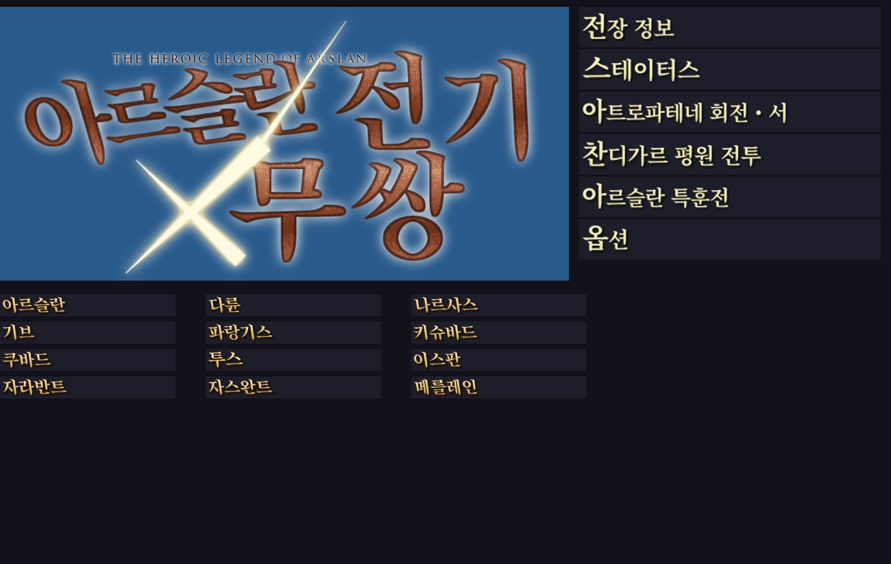

# 아르슬란 전기×무쌍 한글패치 (PS3 일본판)

**アルスラーン戦記×無双 / The Heroic Legend of Arslan × Musou** — PS3 일본판 **BLJM61308** 전용 비공식 한글패치입니다.

제작: **용가리** (GitHub [@Yonggary6425](https://github.com/Yonggary6425))



## 특징

- **텍스트 전체 한글화**: 스토리 대사, 전투 대사와 전황 메시지, 시나리오 소개, 메뉴, 튜토리얼, 무기·스킬·요리 이름, 인물 소개, 사전(인물·용어·전기·연표) 등 게임 데이터 안의 문장 약 12,000개
- **원본에 가까운 글꼴**: 원본 일본어 폰트와 같은 계열인 Noto Serif KR SemiBold로 한글 1,038자를 원본 폰트 칸 크기와 위치에 맞춰 새로 그림
- **이미지 한글화**: 타이틀 로고, 체력바 옆 붓글씨 이름(25명), 캐릭터 이름(24명), 화면 제목 110종, 메뉴 글자(일반·선택 상태), 승리·패배·임무 개시·임무 완료 등 시스템 이미지
- **안정성**: 원본 파일 구조와 압축 방식을 그대로 유지하고, `LINKDATA.BIN` 크기도 원본과 같음
- **업데이트 1.05 대응** (v1.1): 1.05가 설치하는 `USRDIR\PATCH` 폴더의 텍스트·이미지도 한글화
- **안전한 패처**: 원본 SHA-256 확인 → 적용 → 결과 SHA-256 검증까지 자동으로 진행. 게임 폴더·ISO·1.05 업데이트 폴더 지원, v1.0 적용본은 그대로 v1.1로 갱신

## 지원 버전

| 항목 | 값 |
|---|---|
| 게임 | アルスラーン戦記×無双 (PS3) |
| 패치 버전 | v1.1 (게임 업데이트 1.00 / 1.05 모두 지원) |
| 지역 / 시리얼 | 일본판 / BLJM61308 |
| 원본 LINKDATA.BIN SHA-256 | `1bec91e7d68570297a94c4e27ee7a292b3929b9286da79ece54c99ad7a90defb` |
| 원본 LINKDATA.IDX SHA-256 | `e317ce3c8b3a9f95f6e00c8c0379f0915aab8f1da663ef749f0c1ce71d4c6f9b` |
| 적용 후 LINKDATA.BIN SHA-256 (v1.1) | `4aa48cea612b3009abee7a7e962b50f708d889f88482f7e04323705ce39e2f6f` |
| 적용 후 LINKDATA.IDX SHA-256 (v1.1) | `554539e5ee8587cd803e6a36df88efc5283b3340706383401dbee347ccebe090` |

원본과 한글패치 v1.0 적용본을 지원합니다. 다른 지역판, 다른 한글패치나 개조를 적용한 파일은 지원하지 않으며, 패처가 적용 전에 자동으로 확인합니다.

## 적용 방법

[Releases](../../releases)에서 `Arslan_KOR_Patcher_v1.1.zip`을 받아 압축을 풀고 `Arslan_KOR_Patcher_v1.1.exe`를 실행합니다.

> v1.0을 이미 적용했다면 그 폴더·ISO를 그대로 선택하면 v1.1로 갱신됩니다. 원본을 다시 준비할 필요가 없습니다.
Windows 기본 탑재 .NET Framework 4.x로 동작하며, 별도 설치가 필요 없습니다.

### A. 게임 폴더 방식 (RPCS3 폴더 실행)
1. 원본 게임 폴더(`PS3_GAME`이 들어 있는 폴더)를 **통째로 복사**합니다.
2. 패처에서 **게임 폴더에 적용**을 고르고, 첫 칸에 복사한 폴더를 지정합니다.
   - 복사본의 데이터가 원본/v1.0이 아니면(다른 패치 적용본 등) 둘째 칸에 **수정하지 않은 원본 폴더**를 지정하세요.
3. **한글패치 적용**을 누릅니다. 원본 데이터는 `LINKDATA.BIN.orig`, `LINKDATA.IDX.orig`로 보관됩니다(옵션).

### B. ISO 방식
1. 패처에서 **ISO 파일에 적용**을 고르고, 첫 칸에 **원본 ISO**(또는 v1.0 한글 ISO)를 지정합니다.
2. 둘째 칸에는 `원본이름 [KOR].iso`가 자동으로 들어갑니다. 원본은 그대로 두고 사본에 적용하며, 약 17.5GB의 여유 공간이 필요합니다.
   - 둘째 칸을 비우면 원본 ISO에 직접 적용합니다. 이 경우 백업을 꼭 해두세요.

### C. 업데이트 1.05를 설치한 경우 (추가 단계)
1.05 업데이트는 `dev_hdd0\game\BLJM61308\USRDIR\PATCH`에 메뉴 텍스트와 이미지를 따로 설치하고, 게임은 이 파일을 디스크보다 먼저 읽습니다. A 또는 B를 마친 뒤 아래도 진행하세요.
1. 패처에서 **1.05 업데이트 폴더에 적용**을 고릅니다.
2. RPCS3의 `dev_hdd0\game\BLJM61308` 폴더를 지정하고 **한글패치 적용**을 누릅니다.
   - 바뀌는 파일 4개(`msgdata.bin`, `snvmes100.bin`, `caption_ls.bin`, `menu_info_ls.bin`)의 원본은 `*.orig`로 보관됩니다.
   - PS3 실기는 FTP로 `/dev_hdd0/game/BLJM61308` 폴더를 PC에 복사해 적용한 뒤 다시 덮어쓰면 됩니다.

### ⚠ 반드시 확인: RPCS3 설치 데이터 삭제
이 게임은 처음 실행할 때 데이터를 HDD에 설치하고, 이후에는 설치본을 먼저 읽습니다.
패치 전에 한 번이라도 실행한 적이 있다면 아래 폴더를 **삭제한 뒤** 실행하세요.

```
RPCS3\dev_hdd0\game\BLJM61308GAMEDATA
```

지우지 않으면 한글이 나오지 않거나, 예전 데이터와 섞여 크래시가 날 수 있습니다. 세이브 데이터(`dev_hdd0\home\...\savedata`)는 이 폴더와 별개라 지워지지 않습니다.

## 알려진 사항

- 처음 실행할 때 나오는 **HDD 설치 안내문**은 게임 실행 파일(EBOOT)에 들어 있고 시스템 글꼴로 그려지는 부분이라 이번 버전에서는 일본어로 남아 있습니다.
- 영문 장식 글자(STORY MODE, VICTORY, RANK 등)와 저작권 표기, 갤러리 일부 그림, 음성은 원본 그대로입니다.
- 사전의 정렬 탭(ア/カ/サ…)은 원본의 일본어 읽기 순서를 따르므로 한글 가나다순과 다를 수 있습니다.
- `%s` 자리(인물 이름 등이 들어가는 곳) 뒤 조사는 앞말을 알 수 없어 `을(를)`처럼 표기한 곳이 있습니다.
- PS3 실기 동작은 아직 충분히 확인하지 못했습니다. 제보 부탁드립니다.

## 오류 제보

[Issues](../../issues)에 아래 내용을 함께 남겨 주세요.
- 화면 위치(메뉴 이름, 시나리오, 대사 앞뒤 내용)와 스크린샷
- 실행 환경(RPCS3 버전 / 폴더·ISO 실행 여부)
- 크래시라면 `RPCS3.log`

## 저장소 구성

| 경로 | 내용 |
|---|---|
| `src/Patcher.cs` | 패처 소스 (C#, .NET Framework 4) |
| `data/translation_ja_ko_v1.1.json` | 일본어 → 한국어 번역 대응표 (1.05 추가분 포함) |
| `docs/glossary.md` | 고유명사·용어 표기 기준 |
| `OFL_NotoSerifCJK.txt` | 글꼴 라이선스 |

## 기술 메모

- `LINKDATA.IDX`/`LINKDATA.BIN` 구조(엔트리: 오프셋·원본 크기·압축 크기·압축 여부), KT zlib 청크 압축, 중첩 컨테이너, `LX` 문자열 테이블, 사전(`DICC/DICB/DICW/DICT`)을 직접 해석해 다시 만듭니다.
- 게임은 문자를 Shift-JIS로 처리하므로, 게임에서 쓰지 않는 한자 칸의 폰트 그림을 한글로 바꾸고 번역문을 그 코드로 기록합니다. 문자코드와 폰트 칸의 대응은 EBOOT 안의 표(7,381자)를 따릅니다.
- 한글을 넣을 폰트 칸은 번역문에 그대로 남는 기호(™ 등)의 칸과 겹치지 않도록 고릅니다(v1.1에서 수정).
- 부팅 때 읽는 시스템 파일을 압축 형식으로 바꾸면 크래시가 나기 때문에, 모든 파일의 압축 여부와 청크 크기를 원본과 같게 유지합니다.

## 라이선스 / 고지

- 이 패치는 팬이 만든 비공식 번역이며, 원작과 게임의 권리는 각 권리자(© 荒川弘・田中芳樹・講談社／「アルスラーン戦記」製作委員会・MBS, © コーエーテクモゲームス)에게 있습니다.
- 게임 파일은 배포하지 않습니다. 패처는 정품 원본 데이터가 있어야 동작합니다.
- 한글 글꼴: Noto Serif CJK KR (SIL Open Font License 1.1), Song Myung (SIL OFL 1.1, 로고·이름 이미지에 사용)
- 상업적 이용과 무단 재배포(재업로드)를 금지합니다. 퍼가실 때는 출처(이 저장소 또는 카페 원글)를 밝혀 주세요.
